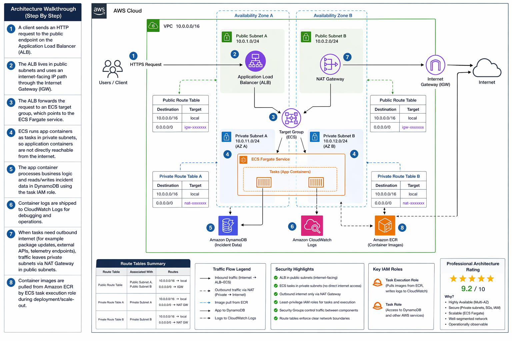
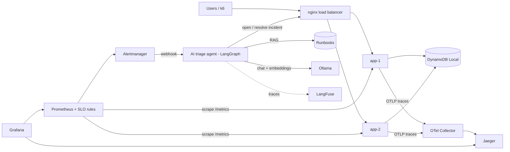
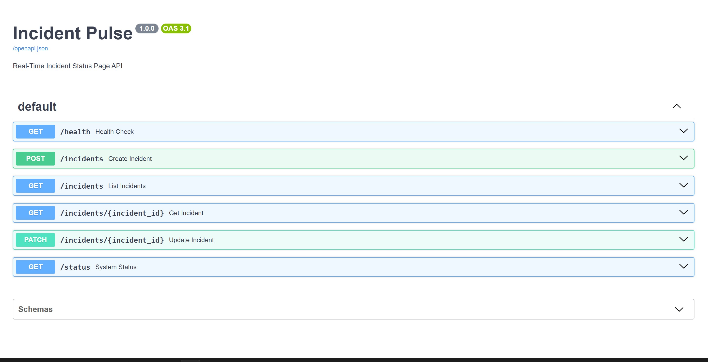
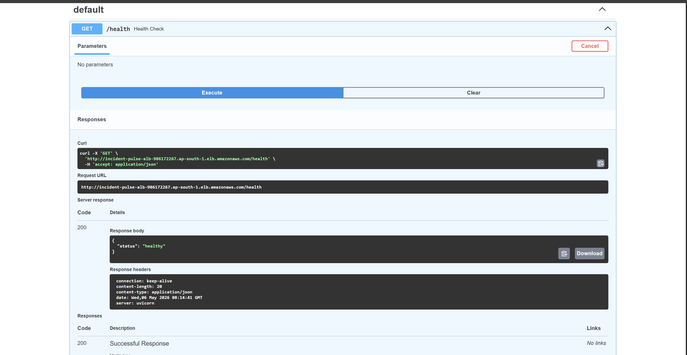
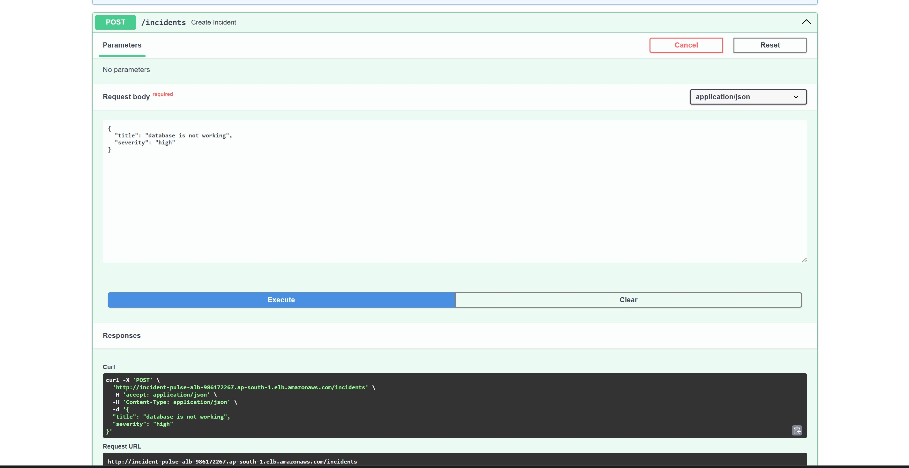
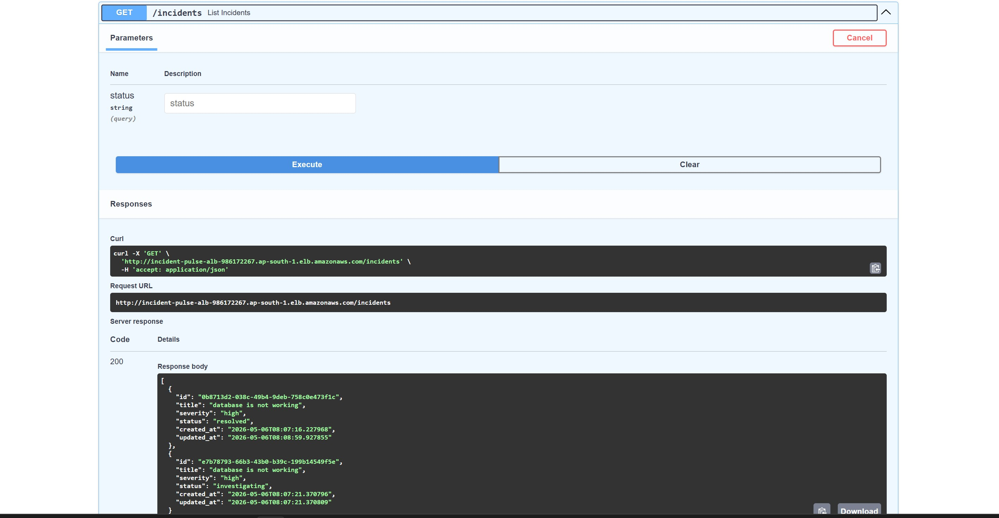
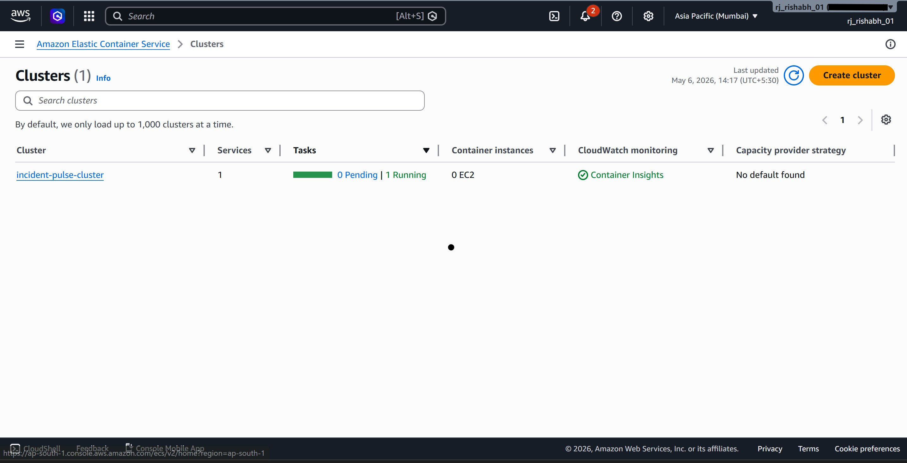
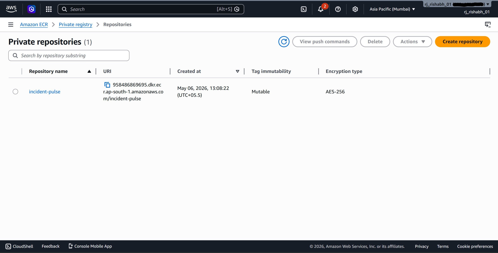
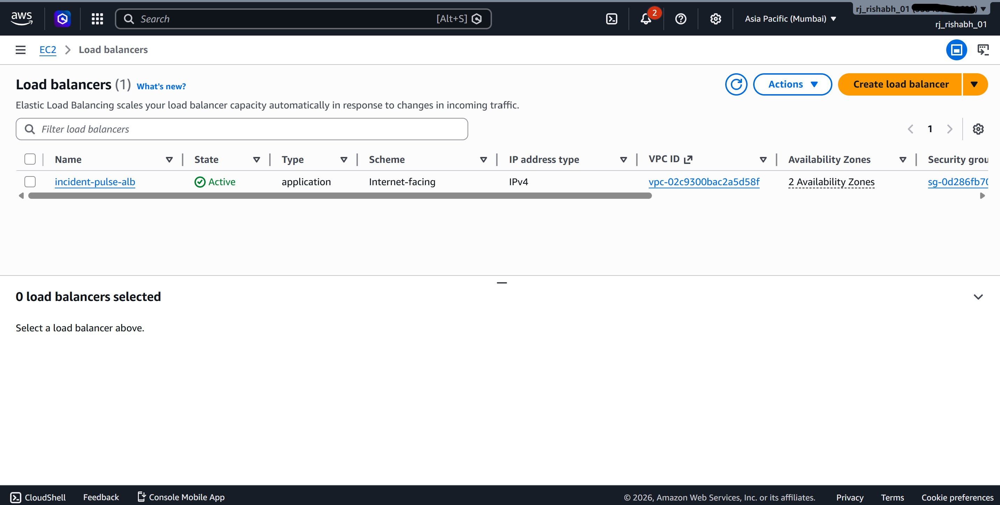
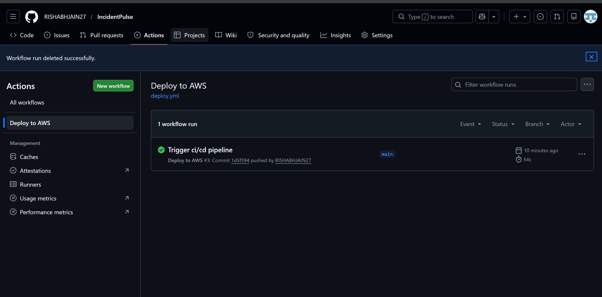

# Incident Pulse

A real-time incident status page API built with Python and FastAPI, deployed on AWS ECS Fargate using Terraform for infrastructure, GitHub Actions for CI/CD, and CloudWatch for monitoring.

It also ships a local **reliability lab**: SLOs with multi-window burn-rate alerts, OpenTelemetry tracing, Grafana dashboards as code, k6 load tests that gate pull requests, Chaos Toolkit experiments, and an AI triage agent (LangGraph + Ollama, traced in LangFuse, evaluated with Promptfoo) that turns alerts into incidents on the status page.

---

## Architecture



### Request Flow

1. A user sends an HTTP request to the public endpoint on the Application Load Balancer (ALB).
2. The ALB lives in public subnets and uses an internet-facing IP path through the Internet Gateway (IGW). It forwards the request to an ECS target group, which points to the ECS Fargate service.
3. ECS runs application containers as tasks in private subnets, so containers are not directly reachable from the internet.
4. The app container processes business logic and reads/writes incident data in DynamoDB using the task IAM role.
5. Container logs are shipped to CloudWatch Logs for debugging and operations.
6. When containers need outbound internet access (for example, pulling images during deployment), traffic leaves private subnets via the NAT Gateway in public subnets.
7. Container images are pulled from Amazon ECR by the ECS task execution role during deployment and scale-out.

### Reliability Lab (local, `docker compose`)



1. Two app replicas sit behind nginx, standing in for two ECS tasks behind the ALB.
2. Each replica exposes Prometheus metrics at `/metrics`, the source of the SLIs, and sends OpenTelemetry traces (including every DynamoDB call) through the Collector to Jaeger.
3. Prometheus evaluates the SLOs (`docs/slo.md`): 99.5% availability and 95% of requests under 300 ms. It fires multi-window, multi-burn-rate alerts to Alertmanager.
4. Alertmanager posts each alert to the triage agent. The agent retrieves the matching runbook, asks a local LLM for a triage note, checks the note against guardrails, and opens an incident on the status page. When the alert resolves, the agent resolves the incident.

---

## Tech Stack

| Layer | Tool |
|-------|------|
| App | Python, FastAPI |
| Database | Amazon DynamoDB |
| Containerization | Docker |
| Compute | AWS ECS Fargate |
| Networking | VPC, ALB, Security Groups |
| IaC | Terraform |
| CI/CD | GitHub Actions |
| Registry | Amazon ECR |
| Monitoring | Amazon CloudWatch, SNS |
| Security | IAM Roles & Policies |
| Metrics, SLOs & Alerting | Prometheus, Alertmanager, Grafana (dashboards as code) |
| Tracing | OpenTelemetry (SDK + Collector), Jaeger |
| Load & Capacity Testing | k6 |
| Chaos Engineering | Chaos Toolkit |
| AI Triage | LangGraph, Ollama (local LLM + embeddings), LangFuse, Promptfoo |

---

## Features

### API Features

- **Create Incident** — log a new incident with a title and severity level
- **List Incidents** — retrieve all incidents, with optional status filtering
- **Get Incident** — fetch a single incident by ID
- **Update Incident** — update the status of an existing incident
- **System Status** — view overall system health based on active incidents
- **Health Check** — verify the API is running and responsive

### DevOps Features

- **Containerized** — application packaged as a Docker image for consistent deployments
- **Infrastructure as Code** — all AWS resources defined in Terraform across 7 modules (networking, ECR, IAM, ALB, DynamoDB, ECS, monitoring)
- **Automated CI/CD** — GitHub Actions pipeline builds, pushes to ECR, and deploys to ECS on every push to main
- **Monitoring & Alerting** — CloudWatch alarm triggers SNS email notification when running tasks drop to zero
- **Centralized Logging** — container logs shipped to CloudWatch Logs with 7-day retention
- **Security Best Practices** — containers run in private subnets, least-privilege IAM policies, security groups restrict traffic between layers

### Reliability Features

- **SLOs and error budgets** — availability and latency SLOs with an error budget policy (`docs/slo.md`)
- **Multi-window, multi-burn-rate alerts** — page on fast burn and open a ticket on slow burn; the rules are unit-tested with `promtool test rules`
- **Distributed tracing** — OpenTelemetry spans for every request and DynamoDB call, viewable in Jaeger
- **Dashboards as code** — the Grafana SLO dashboard is version-controlled JSON, provisioned automatically
- **Liveness vs. readiness** — `/health` (process is up) and `/ready` (can reach DynamoDB) are separate endpoints
- **Fail-fast dependencies** — bounded boto3 timeouts and retries, so a slow database produces fast errors, not hung requests
- **SLO-gated CI** — every pull request runs unit tests, rule tests and a k6 smoke test whose thresholds are the SLOs
- **Load and capacity tests** — k6 smoke, load and stress (step-up arrival rate) scenarios
- **Chaos experiments** — replica loss (proves failover) and DynamoDB brownout (proves detection and recovery)
- **Failure mode analysis** — what can break, its impact, detection, mitigation and proof (`docs/failure-mode-analysis.md`)
- **AI incident triage** — a LangGraph agent with RAG over the runbooks, guardrails (no destructive commands, must cite a runbook, never downgrade a page), retry with feedback, a rule-based fallback when the LLM is down or wrong, LangFuse tracing and a Promptfoo eval suite that includes a prompt-injection case

---

## Screenshots

### Swagger UI — Interactive API Documentation


### Health Check Endpoint


### Create Incident


### List Incidents


### AWS ECS — Running Service


### AWS ECR — Container Registry


### AWS ALB — Load Balancer


### CI/CD Pipeline — GitHub Actions


---

## Project Structure

```
IncidentPulse/
├── .github/workflows/
│   └── deploy.yml            # CI/CD pipeline
├── app/
│   ├── main.py               # FastAPI application and routes
│   ├── models.py             # Pydantic models and enums
│   ├── database.py           # DynamoDB operations
│   └── config.py             # Environment configuration
├── terraform/
│   ├── main.tf               # Root module — wires all modules together
│   ├── variables.tf          # Root variables
│   ├── backend.tf            # S3 remote state configuration
│   ├── provider.tf           # AWS provider setup
│   └── modules/
│       ├── networking/       # VPC, subnets, IGW, NAT, route tables
│       ├── ecr/              # Container registry
│       ├── iam/              # Task execution and task roles
│       ├── alb/              # Load balancer, target group, listener
│       ├── dynamodb/         # Incidents table
│       ├── ecs/              # Cluster, task definition, service
│       └── monitoring/       # CloudWatch logs, alarms, SNS
├── tests/
│   ├── test_main.py          # API tests with mocked DynamoDB
│   └── test_observability.py # Metrics, readiness and SLI labelling tests
├── observability/
│   ├── prometheus/           # Scrape config, SLO rules, promtool rule tests
│   ├── alertmanager/         # Routing to the triage agent, inhibition
│   ├── grafana/              # Provisioned datasources and SLO dashboard (JSON)
│   ├── otel-collector/       # OTLP in, Jaeger out
│   ├── nginx/                # Local load balancer (ALB stand-in)
│   └── langfuse/             # Self-hosted LangFuse (optional)
├── loadtest/                 # k6: smoke, load, stress, chaos background traffic
├── chaos/                    # Chaos Toolkit experiments and probes
├── triage/                   # AI triage agent (LangGraph, FastAPI, tests)
├── runbooks/                 # Runbooks: on-call docs and the agent's knowledge base
├── evals/                    # Promptfoo eval suite for the triage agent
├── docs/                     # SLOs, failure mode analysis
├── docker-compose.yml        # The local reliability lab
├── Dockerfile                # Container image definition
├── requirements.txt          # Python dependencies
└── .gitignore
```

---

## Run Locally

### Prerequisites
- Python 3.12
- Docker Desktop
- DynamoDB Local (for local development)

### Steps

```bash
# Clone the repo
git clone https://github.com/RISHABHJAIN27/IncidentPulse.git
cd IncidentPulse

# Create virtual environment
python -m venv venv
source venv/bin/activate        # Linux/Mac
venv\Scripts\activate           # Windows

# Install dependencies
pip install -r requirements.txt

# Start DynamoDB Local
docker run -d -p 8001:8000 amazon/dynamodb-local

# Create the local table
python db_check.py

# Run the app
uvicorn app.main:app --reload --port 8000
```

Visit `http://localhost:8000/docs` to access the Swagger UI.

---

## Run the Reliability Lab

### Prerequisites
- Docker Desktop with at least 8 GB of memory (about 12 GB with LangFuse)
- [Ollama](https://ollama.com/download), with the two models pulled:
  ```bash
  ollama pull llama3.2:3b
  ollama pull nomic-embed-text
  ```
- Python 3.12 (only for the chaos experiments and the evals)

The triage agent still works without Ollama: it falls back to runbook-only triage notes.

### Start everything

```bash
docker compose up -d --build
```

| What | URL |
|------|-----|
| API (through the load balancer) | http://localhost:8080/docs |
| Grafana: "Incident Pulse - SLOs" dashboard | http://localhost:3000 |
| Prometheus: rules and alerts | http://localhost:9090/alerts |
| Alertmanager | http://localhost:9093 |
| Jaeger: traces | http://localhost:16686 |
| Triage agent | http://localhost:8090/docs |

### Load testing

```bash
docker compose run --rm --no-deps k6 run /scripts/smoke.js    # 30 s, fails if the SLOs would break
docker compose run --rm --no-deps k6 run /scripts/load.js     # ramp to 25 users, per-endpoint thresholds
docker compose run --rm --no-deps k6 run /scripts/stress.js   # step up to 200 req/s to find the limit
```

### Chaos experiments

```bash
pip install chaostoolkit
chaos run chaos/replica-loss.json         # kill a replica: SLOs must hold through failover
chaos run chaos/dynamodb-brownout.json    # freeze DynamoDB: alert must page, service must recover (~8 min)
```

Run them from the repo root with the lab up. Results are written to `journal.json`.

### Watch an incident end to end

```bash
# Terminal 1: steady traffic for 6 minutes
docker compose run --rm --no-deps -e DURATION=6m -e RATE=10 k6 run --no-thresholds /scripts/chaos-background.js

# Terminal 2: DynamoDB stops answering
docker pause incidentpulse-dynamodb
```

1. Within about 4 minutes, `IncidentPulseAvailabilityBudgetBurnFast` fires (Prometheus → Alerts).
2. Alertmanager sends it to the triage agent: see `http://localhost:8090/triage/history`.
3. The status page cannot save the incident while its own database is down, so the agent keeps it and retries (see `docs/failure-mode-analysis.md`).
4. Run `docker unpause incidentpulse-dynamodb`. The incident appears at `http://localhost:8080/incidents`, and it is resolved when the alert clears.

### LLM tracing with self-hosted LangFuse

```bash
docker compose -f docker-compose.yml -f observability/langfuse/docker-compose.langfuse.yml up -d --build
```

Open http://localhost:3100 and sign in as `admin@incidentpulse.local` / `incidentpulse-local` (local-only defaults). Every triage run appears as a trace: retrieval, each LLM draft, guardrail decisions and the fallback.

### Evaluate the triage agent

```bash
pip install -r triage/requirements.txt
npx promptfoo@latest eval -c evals/promptfooconfig.yaml
npx promptfoo@latest view
```

Six cases cover triage quality, grounding and a prompt-injection attempt. Safety assertions must pass; `llm_note_accepted` reports how often the model's own draft passed the guardrails.

### Tests

```bash
python -m pytest                                   # app
cd triage && pip install -r requirements-dev.txt && python -m pytest   # triage agent
docker run --rm -v "${PWD}/observability/prometheus:/p" --entrypoint promtool prom/prometheus:v3.15.1 test rules /p/tests/slo.test.yml
```

---

## Deploy to AWS

### Prerequisites
- AWS CLI configured with valid credentials
- Terraform installed
- Docker Desktop running

### Steps

```bash
# Navigate to terraform directory
cd terraform

# Create a terraform.tfvars file with your email
echo 'alert_email = "your@email.com"' > terraform.tfvars

# Initialize and deploy infrastructure
terraform init
terraform apply

# The CI/CD pipeline handles the rest —
# push any change to main and GitHub Actions will:
# 1. Build the Docker image
# 2. Push to ECR
# 3. Update the ECS service
git add .
git commit -m "Deploy"
git push origin main
```

### Tear Down

```bash
terraform destroy
```

---

## CI/CD Pipeline

The GitHub Actions workflow (`.github/workflows/deploy.yml`) runs on every push to `main`:

```
Push to main → Checkout code → Configure AWS → Login ECR → Build & Push image → Update ECS
```

The reliability workflow (`.github/workflows/reliability.yml`) runs on every pull request:

```
Unit tests (app + triage agent) → promtool rule tests + config checks → compose up → k6 smoke test against the SLOs
```

**Required GitHub Secrets (deploy workflow):**
- `AWS_ACCESS_KEY_ID`
- `AWS_SECRET_ACCESS_KEY`
- `AWS_REGION`
- `ECS_CLUSTER_NAME`
- `ECS_SERVICE_NAME`

---

## Monitoring & Alerting

- **CloudWatch Logs** — all container logs are shipped to `/ecs/incident-pulse` with 7-day retention
- **CloudWatch Alarm** — triggers when ECS running task count drops below 1
- **SNS Notification** — alarm sends an email alert so you know immediately when the service is down

Locally, the reliability lab adds SLO burn-rate alerting with Prometheus and Alertmanager, Grafana dashboards and Jaeger traces. See [Run the Reliability Lab](#run-the-reliability-lab).

---

## API Endpoints

| Method | Endpoint | Description |
|--------|----------|-------------|
| GET | `/health` | Liveness: the process is up |
| GET | `/ready` | Readiness: DynamoDB is reachable (503 if not) |
| GET | `/metrics` | Prometheus metrics (SLI source) |
| POST | `/incidents` | Create a new incident |
| GET | `/incidents` | List all incidents (optional status filter) |
| GET | `/incidents/{id}` | Get a specific incident |
| PATCH | `/incidents/{id}` | Update incident status |
| GET | `/status` | System status overview |

---

## Author

**Rishabh Jain**

Built as a hands-on DevOps and SRE portfolio project to demonstrate end-to-end cloud infrastructure, containerization, CI/CD automation, SLO-based monitoring, chaos engineering and AI-assisted incident response.